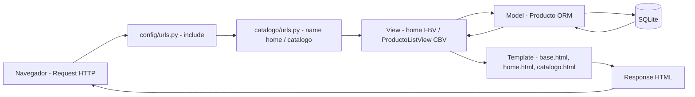

# TechZone – Catálogo de Productos Tecnológicos (Django MTV)

Guía Práctica Grupal Semana 11 – **Desarrollo de Aplicaciones Web (IS093A)**
Universidad Nacional del Centro del Perú – Facultad de Ingeniería de Sistemas

**Autora:** Jackeline Vivanco Solano
**Modalidad:** Desarrollo individual (roles asumidos por la autora)

| Rol | Responsabilidad cumplida |
|---|---|
| Arquitecto Django | `startproject config`, `startapp catalogo`, `settings.py` (apps, `TEMPLATES.DIRS`, idioma), `urls.py` con `include()` |
| Desarrollador de Vistas | FBV `home` y CBV `ProductoListView` (ListView) con contexto y QuerySets |
| Ingeniero de Plantillas | `base.html` + herencia, bloques, tags `for/if/empty/url`, filtros, diseño responsive |
| QA & ORM Validator | Modelo, `makemigrations`/`migrate`, fixture, QuerySets, `manage.py check`, README |

---

## Tecnologías

| Herramienta | Versión |
|---|---|
| Python | 3.13 |
| Django | 6.1.3 |
| Base de datos | SQLite |
| Estilos | CSS propio (Grid responsive) |

## Funcionalidades

- `/` → **FBV** de bienvenida con contadores (total, disponibles, agotados).
- `/catalogo/` → **CBV `ListView`** con productos en stock ordenados por precio.
- Filtro por categoría (`?categoria=Accesorios`) y búsqueda por nombre (`?q=samsung`).
- Etiqueta condicional de stock: *Stock*, *¡Últimas unidades!* (≤ 5) y *Agotado* (= 0).
- Panel `/admin/` con el modelo `Producto` registrado.

---

## Diagrama MTV



| Capa MTV | Archivo | Función |
|---|---|---|
| **Model** | `catalogo/models.py` | Define `Producto` y accede a los datos con el ORM |
| **View** | `catalogo/views.py` | Lógica: consulta el modelo y arma el contexto |
| **Template** | `templates/*.html` | Presentación: muestra los datos con herencia y filtros |
| URLs | `config/urls.py`, `catalogo/urls.py` | Enrutan cada petición a su vista |

---

## Modelo

```python
class Producto(models.Model):
    nombre = models.CharField(max_length=100)
    precio = models.DecimalField(max_digits=8, decimal_places=2)
    categoria = models.CharField(max_length=50)
    stock = models.PositiveIntegerField()
    creado_en = models.DateTimeField(auto_now_add=True)
```

## QuerySets utilizados

**1. Productos disponibles ordenados por precio** (vista `ProductoListView`):

```python
Producto.objects.filter(stock__gt=0).order_by("precio")
```
Devuelve solo productos con stock mayor a 0, de menor a mayor precio. El `order_by("precio")` reemplaza el orden por defecto del modelo (`Meta.ordering = ["-creado_en"]`).

**2. Filtro por categoría** (encadenado sobre el anterior):

```python
queryset.filter(categoria__iexact=categoria)
```
Filtra por la categoría recibida en la URL sin distinguir mayúsculas.

**3. Búsqueda por nombre:**

```python
queryset.filter(nombre__icontains=q)
```

Además, la FBV `home` usa `Producto.objects.count()` y `Producto.objects.filter(stock=0).count()`.

### Lazy evaluation

Los QuerySets de Django son **perezosos (lazy)**: crear o encadenar un QuerySet **no** consulta la base de datos, solo arma la consulta SQL. La consulta se ejecuta recién cuando el QuerySet se **evalúa**: al recorrerlo con `for`, al usar `len()`, `list()`, `count()`, al imprimirlo o al usarlo en la plantilla.

```python
qs = Producto.objects.filter(stock=0)   # no consulta la BD
print(qs.query)                          # muestra el SQL, aún sin ejecutarlo
len(qs)                                  # aquí recién se ejecuta → 2
```

Por eso en `ProductoListView` se encadenan `filter(stock__gt=0)`, `filter(categoria__iexact=...)` y `filter(nombre__icontains=...)`, y se genera **una sola consulta SQL** cuando la plantilla recorre `productos`.

---

## Plantillas

- `base.html`: header con enlaces `` y ``, `` y footer.
- `home.html` y `catalogo.html`: ``.
- Tags: ``, ``, `//`, ``, ``.
- Filtros: `title`, `upper`, `lower`,